# Конструювання програмного забезпечення — практична робота

Клієнт-серверний застосунок «Задачі», побудований на репозиторіях-стартерах курсу:

- **сервер** — [mkosir/typeorm-express-typescript](https://github.com/mkosir/typeorm-express-typescript) (Express + TypeScript + TypeORM + PostgreSQL), каталог [`server/`](server);
- **клієнт** — [RicardoValdovinos/vite-react-boilerplate](https://github.com/RicardoValdovinos/vite-react-boilerplate) (Vite + React + TanStack Router/Query + Tailwind), каталог [`client/`](client).

Що зроблено за завданням:

| Пункт завдання | Результат |
|---|---|
| Склонувати репозиторії та запустити їх у режимі debugger | Обидва стартери запущені; додано скрипти `dev:local` / `dev:debug` і конфігурації VS Code ([`.vscode/launch.json`](.vscode/launch.json)) |
| Дослідити роботу запитами та перевіркою стану на breakpoints | 4 сеанси налагодження з точками зупину, логи в [`docs/debug/`](docs/debug) |
| Внести зміни в код і підтвердити очікуваний результат | 10 виправлень у стартерах, кожне перевірене (таблиця в розділі 3) |
| Створити нову сутність на бекенді та CRUD через REST API | Сутність `Task`, міграція, сид, модуль `/v1/tasks` (controller → service → repository), 12 інтеграційних тестів |
| Додати в клієнт UI для CRUD із запитами до сервера | Сторінки входу та задач: список, фільтр, пошук, створення, редагування, виконання, видалення; e2e-тест Playwright |

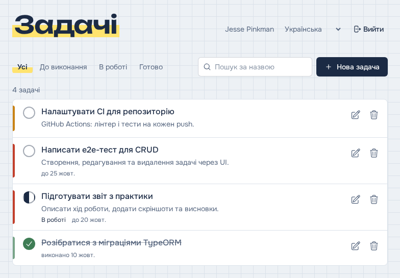

---

## Зміст

1. [Запуск](#запуск)
2. [Дослідження стартерів у режимі налагодження](#2-дослідження-стартерів-у-режимі-налагодження)
3. [Зміни в коді стартерів і їх перевірка](#3-зміни-в-коді-стартерів-і-їх-перевірка)
4. [Бекенд: сутність Task і REST API](#4-бекенд-сутність-task-і-rest-api)
5. [Клієнт: UI для CRUD](#5-клієнт-ui-для-crud)
6. [Тестування](#6-тестування)
7. [Зв'язок із лекціями](#7-звязок-із-лекціями)
8. [Висновки](#8-висновки)
9. [Відомі обмеження](#9-відомі-обмеження)

Історія комітів відображає хід роботи: перший коміт — стартери без змін, далі кожен крок окремим комітом (`git log --oneline`).

---

## Запуск

Інструкції наведено для Windows (PowerShell); на Linux і macOS команди ті самі.

### Вимоги

- [Node.js](https://nodejs.org) 22.12 або новіший (LTS), разом із ним встановлюється npm;
- pnpm: `npm install -g pnpm`;
- [Git](https://git-scm.com);
- PostgreSQL — через [Docker Desktop](https://www.docker.com/products/docker-desktop/) **або** [інсталятор PostgreSQL](https://www.postgresql.org/download/windows/).

### 1. База даних

**Варіант А — Docker Desktop.** Одна команда створює базу з даними з `server/.env`:

```powershell
docker run --name kpz-postgres -e POSTGRES_USER=walter -e POSTGRES_PASSWORD=white -e POSTGRES_DB=boilerplate -p 5432:5432 -d postgres:16
```

Наступного разу достатньо `docker start kpz-postgres`.

**Варіант Б — інсталятор PostgreSQL.** Після встановлення відкрити *SQL Shell (psql)* з меню «Пуск», увійти користувачем `postgres` і виконати:

```sql
CREATE ROLE walter LOGIN SUPERUSER PASSWORD 'white';
CREATE DATABASE boilerplate OWNER walter;
```

### 2. Сервер (API)

```powershell
cd server
npm ci
npm run migration:run:dev   # таблиці users і tasks
npm run seed:run:dev        # 10 користувачів + 5 демо-задач
npm run dev:local           # API на http://localhost:4000
```

Перевірка всього CRUD через HTTP: `npm run demo:api` (в іншому вікні терміналу).

Повернути демо-задачі до початкового стану: `npm run db:demo-reset`.

### 3. Клієнт

```powershell
cd client
pnpm install
pnpm dev                    # http://localhost:5173
```

Адреса API задається у [`client/.env`](client/.env) (`VITE_API_URL`, за замовчуванням `http://localhost:4000/v1`).

### Тестові акаунти

| Email | Пароль | Роль | Що бачить |
|---|---|---|---|
| `standard@standard.com` | `pass1` | STANDARD | лише свої задачі (4 демо-задачі) |
| `admin@admin.com` | `pass1` | ADMINISTRATOR | задачі всіх користувачів з автором |

На сторінці входу є кнопка «Заповнити тестовим акаунтом».

### Запуск у режимі налагодження

**VS Code.** У [`.vscode/launch.json`](.vscode/launch.json) є готові конфігурації:

- *Server: launch with debugger* — запускає `npm run dev:local` і автоматично під'єднується до процесу ts-node-dev;
- *Server: attach to :9229* — для `npm run dev:debug` (сервер з `--inspect=127.0.0.1:9229`);
- *Client: Chrome on Vite dev server* — браузер з відладкою TSX через source maps;
- *Full stack* — сервер і клієнт разом.

**WebStorm.** Сервер: *Run → Edit Configurations → + npm*, скрипт `dev:local`, кнопка *Debug*. Клієнт: `pnpm dev`, потім конфігурація *JavaScript Debug* з URL `http://localhost:5173`.

**Без IDE.** `npm run dev:debug`, потім у Chrome або Edge відкрити `chrome://inspect` (`edge://inspect`) → *Open dedicated DevTools for Node*.

### Скріншоти й протоколи налагодження

Скріншоти в [`docs/screenshots/`](docs/screenshots) знімаються автоматично тим самим сценарієм, що й у звіті (на Windows — у встановленому Microsoft Edge):

```powershell
cd client
pnpm shots                  # потрібен запущений API; демо-дані скидаються автоматично
```

Скріншот 01 (помилка стартера) знімається вручну. У файлі `client/src/common/i18n.ts` тимчасово повернути імпорт стартера — замінити `"./utilities"` на `"./utils"`, — відкрити `http://localhost:5173`, зробити знімок (Win + Shift + S), зберегти як `docs/screenshots/01-client-starter-broken.png` і повернути файл:

```powershell
git checkout -- client/src/common/i18n.ts
```

Протоколи сеансів 1, 3 і 4 у [`docs/debug/`](docs/debug) оновлюються командою `npm run debug:sessions` (у каталозі `server`, при запущеному `npm run dev:debug`).

---

## 2. Дослідження стартерів у режимі налагодження

Сервер запускався під інспектором Node (`dev:debug`), точки зупину ставились у TypeScript-файлах, після чого надсилались HTTP-запити, а стан застосунку перевірявся на паузі. Протоколи сеансів записує скрипт [`server/scripts/debug-sessions/run.mjs`](server/scripts/debug-sessions/run.mjs) через Chrome DevTools Protocol — той самий протокол, яким користуються VS Code і WebStorm, — тому в логах видно стек викликів, локальні змінні та значення виразів на момент зупинки.

| Сеанс | Точка зупину | Що з'ясовано |
|---|---|---|
| [1. Логін](docs/debug/session1-login.md) | `controllers/auth/login.ts:22`, перед перевіркою пароля | `findOne` повернув користувача з bcrypt-хешем (`$2a$08$…`); `checkIfPasswordMatch('pass1')` → `true`, з іншим паролем → `false`; відповідь — `Bearer <JWT>` |
| [2. Невалідний JSON](docs/debug/session2-error-before.md) | `middleware/errorHandler.ts:6` (вихідна версія) | У обробник потрапляє `SyntaxError` від body-parser, а не `CustomError`: `err.HttpStatusCode === undefined`, тому `res.status(undefined)` падає і клієнт отримує **HTML 500** замість JSON. **Знайдена помилка стартера** |
| [3. Після виправлення](docs/debug/session3-error-after.md) | `middleware/errorHandler.ts:29` | Той самий запит: помилка загорнута в `CustomError(400)`, відповідь — JSON `Invalid JSON in request body` |
| [4. Оновлення задачі](docs/debug/session4-task-update.md) | `modules/tasks/task.service.ts:58` | На паузі видно: `user` з JWT, `dto = {status: "DONE"}`, перевірка власника `task.ownerId === user.id` → `true`; у `task.owner` лише `id, email, name` — хеш пароля не вибирається з БД |

На клієнті для дослідження використовувались React/TanStack-інструменти: панель TanStack Query показує ключ кешу `["tasks","list",{status,q}]`, стан запиту і дані з API.

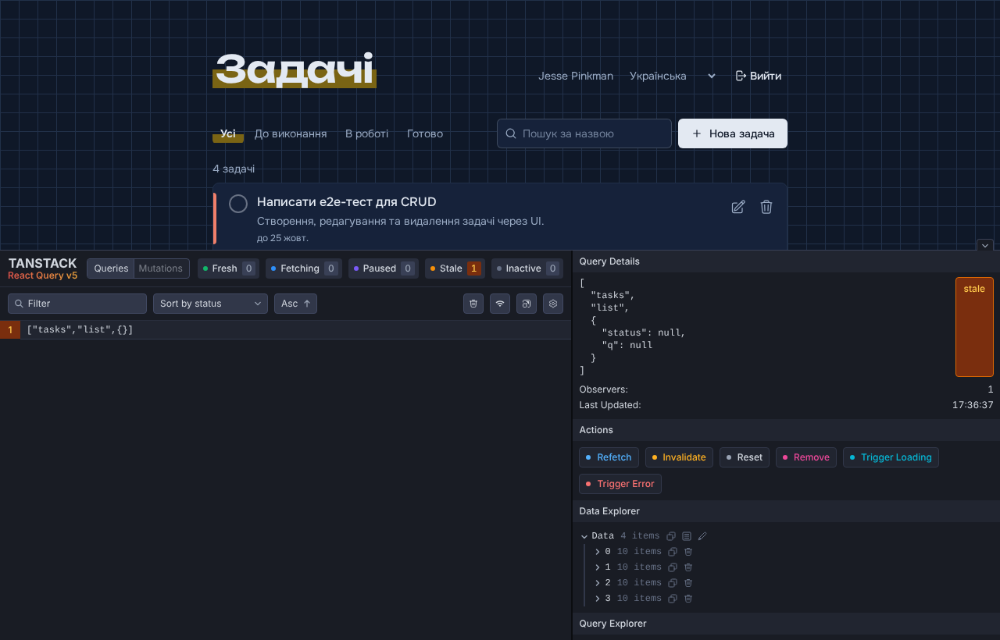

---

## 3. Зміни в коді стартерів і їх перевірка

Під час запуску та налагодження в стартерах знайдено низку проблем. Кожну виправлено окремим комітом і перевірено.

| # | Проблема | Як виявлено | Виправлення | Перевірка |
|---|---|---|---|---|
| 1 | Клієнт не запускається: імпорт `common/utils`, а файл називається `common/utilities.ts` | Vite: *Failed to resolve import* (скріншот 01) | Виправлено імпорти | Сторінка відкривається, `tsc` без помилок |
| 2 | Тести сервера падають поза Docker: `ormconfig` читає `process.env` до завантаження `.env` | `npm test` → *no PostgreSQL user name specified* | `mocha --require dotenv/config` | 8/8 тестів стартера проходять |
| 3 | `index.ts` і тести одночасно викликають `createConnection('default')`, TypeORM замінює ще не відкрите з'єднання | Читання коду `ConnectionManager.create` | Один спільний `Promise` у `dbCreateConnection` | Тести стабільні |
| 4 | Невалідний JSON → HTML 500 + stack trace | Сеанс налагодження 2 | `errorHandler` обробляє будь-які помилки; stack приховується поза `NODE_ENV=dev` | Сеанс 3; тест `errorHandler.test.ts` |
| 5 | Оновлений JWT у заголовку `token` недоступний браузеру (CORS) | `curl -i -H Origin:` — немає `Access-Control-Expose-Headers` | `cors({ exposedHeaders: ['token'] })` | Заголовок `Access-Control-Expose-Headers: token` присутній; клієнт оновлює токен |
| 6 | `userRepository.delete(id)` без `await` у `users/destroy.ts` | Код-рев'ю | Додано `await` | Помилки БД тепер потрапляють у `catch` |
| 7 | `migration:generate` пропонував `DROP COLUMN email/username/name` — сутність `User` розійшлась зі схемою (немає `length`) | Перша автогенерована міграція | Довжини колонок у `User.ts` приведено до міграції | Повторна генерація містить лише таблицю `tasks` |
| 8 | Vitest падає на кожному файлі: `import matchers from '@testing-library/jest-dom/matchers'` дає `undefined` у jest-dom v6 | `pnpm test:unit` | `import '@testing-library/jest-dom/vitest'` | 5/5 unit-тестів |
| 9 | `npm install` у `server/` падає: `husky install` не знаходить `.git` (монорепозиторій, Docker-збірка) | `npm run prepare` → exit 1 | `husky install \|\| echo …` | `npm ci` у чистому клоні проходить |
| 10 | npm-скрипти сервера не працюють у Windows: змінні у вигляді `VAR=value команда`, glob в одинарних лапках, запуск `.bin/typeorm` через ts-node | запуск скриптів у PowerShell | `cross-env`, подвійні лапки, `typeorm/cli.js`; `.gitattributes` фіксує LF-кінці рядків | скрипти й тести запускаються у Windows |

---

## 4. Бекенд: сутність Task і REST API

### Модель даних

Таблиця `tasks` (міграція [`CreateTasks`](server/src/orm/migrations)), зв'язок **багато-до-одного** з `users`:

| Поле | Тип у БД | Обмеження |
|---|---|---|
| `id` | `serial` | PK |
| `title` | `varchar(120)` | NOT NULL |
| `description` | `text` | NULL |
| `status` | `varchar(20)` | `TODO` \| `IN_PROGRESS` \| `DONE`, default `TODO` |
| `priority` | `varchar(10)` | `LOW` \| `MEDIUM` \| `HIGH`, default `MEDIUM` |
| `due_date` | `date` | NULL |
| `completed_at` | `timestamptz` | NULL, встановлює сервер |
| `owner_id` | `integer` | FK → `users.id` ON DELETE CASCADE, індекс |
| `created_at`, `updated_at` | `timestamptz` | default `now()` |

Міграцію згенеровано командою `npm run migration:generate -- CreateTasks`, перевірено `migration:run` → `migration:revert` → `migration:run`.

Два рішення, прийняті після перевірки:

- **автогенеровану міграцію треба читати.** Перша версія містила видалення колонок `users` (див. пункт 7 у розділі 3);
- **`timestamptz` замість `timestamp`.** З простим `timestamp` значення `now()` у БД (UTC) і дати з Node (Europe/Berlin) розходились на 2 години: `createdAt` повертався зі зсувом, а `completedAt` — правильно.

### Архітектура модуля

Шарова архітектура з лекцій, кожен шар — окремий файл у [`server/src/modules/tasks/`](server/src/modules/tasks):

```
HTTP ─▶ task.routes.ts      checkJwt (router-level), validateTaskBody (route-level), composition root (DI)
        task.controller.ts  тонкий: HTTP ⇄ виклики сервісу, коди відповідей
        task.service.ts     бізнес-правила: власник, роль адміністратора, completedAt
        task.repository.ts  TypeORM QueryBuilder: фільтри, пошук, сортування, join власника
        task.dto.ts         вхідні DTO + валідація/whitelisting, вихідний DTO
DB  ◀─  orm/entities/tasks/Task.ts
```

Залежності передаються через конструктори: `new TaskController(new TaskService(new TaskRepository()))`. `asyncHandler` прибирає однакові `try/catch` з контролера.

### REST API

Усі ендпоінти вимагають заголовок `Authorization: Bearer <JWT>` (отримується з `POST /v1/auth/login`).

| Метод | URL | Тіло / параметри | Успіх | Помилки |
|---|---|---|---|---|
| GET | `/v1/tasks` | `?status=TODO\|IN_PROGRESS\|DONE`, `?search=текст` | 200, масив | 400 — невідомий статус |
| GET | `/v1/tasks/:id` | — | 200 | 404 — немає або чужа |
| POST | `/v1/tasks` | `title`*, `description`, `status`, `priority`, `dueDate` (`YYYY-MM-DD`) | 201 + заголовок `Location` | 400 — валідація |
| PATCH | `/v1/tasks/:id` | будь-яка підмножина полів | 200 | 400, 404 |
| DELETE | `/v1/tasks/:id` | — | 200 `{ id }` | 404 |

Правила:

- звичайний користувач бачить і змінює лише свої задачі, адміністратор — усі;
- чужа задача повертає **404, а не 403**, щоб API не розкривав, які `id` існують;
- поля `id`, `ownerId`, `completedAt` з тіла запиту ігноруються (whitelisting у DTO);
- `completedAt` ставиться при переході в `DONE` і очищується при поверненні;
- символи `%` і `_` у пошуку екрануються — це текст, а не шаблон `LIKE`;
- відкриті задачі в списку йдуть першими, виконані — нижче.

Приклад (вивід `npm run demo:api` — скрипт [`server/scripts/tasks-api-demo.mjs`](server/scripts/tasks-api-demo.mjs), скорочено):

```
$ POST /v1/tasks
{"message":"Task successfully created.","data":{"id":53,"title":"Здати практику","status":"TODO","priority":"HIGH","dueDate":"2026-10-31",...}}

$ PATCH /v1/tasks/53   {"status":"DONE"}
{"message":"Task successfully updated.","status":"DONE","completedAt":"2026-10-15T13:35:39.366Z"}

$ POST /v1/tasks   (invalid body)
{"errorType":"Validation","errorsValidation":[{"title":"Title is required"},{"status":"Status must be one of: TODO, IN_PROGRESS, DONE"}]}

$ DELETE /v1/tasks/53
{"message":"Task successfully deleted.","data":{"id":53}}

$ GET /v1/tasks/53   (after delete)
HTTP 404
```

---

## 5. Клієнт: UI для CRUD

### Структура

```
client/src/
├── api/http.ts             fetch-обгортка: JWT, оновлення токена, ApiError
├── features/auth/          Zustand-стор сесії, форма входу
├── features/tasks/         API, хуки TanStack Query, схема Zod, компоненти списку і діалогів
├── components/ui/          Button, Modal (Headless UI), FormField, Toaster
├── pages/                  LoginPage, TasksPage, NotFoundPage
├── routes/                 файлові маршрути TanStack Router: /, /login, /tasks
└── assets/locales/         переклади uk (за замовчуванням) і en
```

### Ключові рішення

- **Маршрутизація** — TanStack Router: `/tasks` захищений (`beforeLoad` → `/login`), фільтри зберігаються в URL (`/tasks?status=DONE&q=звіт`) і типізуються через `validateSearch`, тому переживають перезавантаження і кнопку «Назад».
- **Стан.** Серверні дані — TanStack Query: кеш, повторні запити, інвалідація після мутацій. Клієнтський стан — Zustand: сесія в `sessionStorage`, сповіщення.
- **Форми** — React Hook Form + Zod з тими самими обмеженнями, що й на сервері. Якщо сервер усе ж повертає `errorsValidation`, помилки показуються біля відповідних полів.
- **Сесія.** Сервер на кожен запит повертає оновлений JWT у заголовку `token` — клієнт його зберігає. На 401 відбувається вихід із повідомленням «Сесія закінчилась».
- **i18n** — українська та англійська, мова визначається з браузера і перемикається в шапці; множина («4 задачі», «5 задач») через плюральні форми i18next.
- **Доступність.** Діалоги з фокус-пасткою та Escape (Headless UI), підписані поля, `aria-invalid` + `aria-describedby` для помилок, кнопки-іконки з `aria-label`, `aria-pressed` у фільтрах.

### Скріншоти

| | |
|---|---|
| 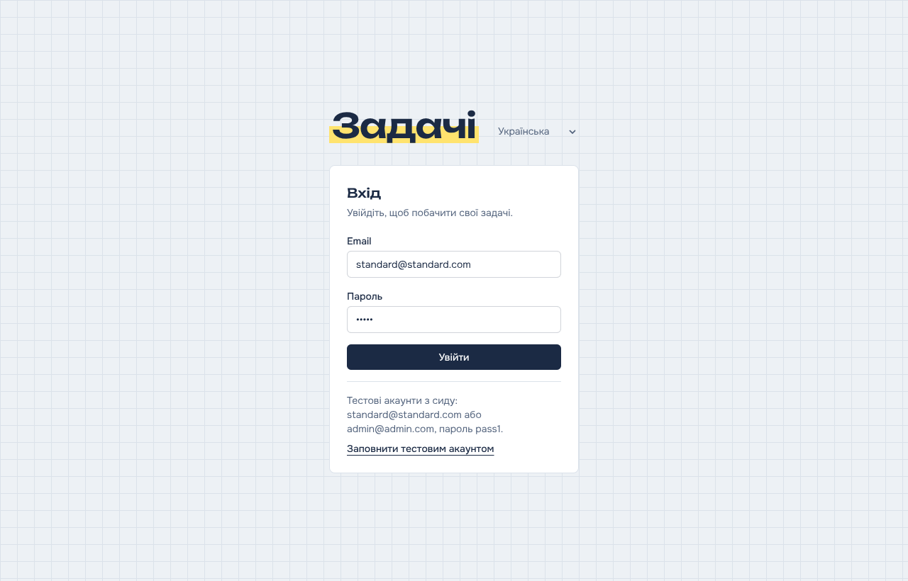 Вхід | 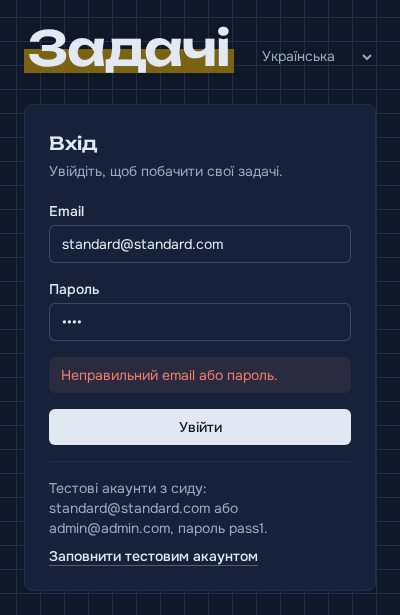 Неправильний пароль |
| 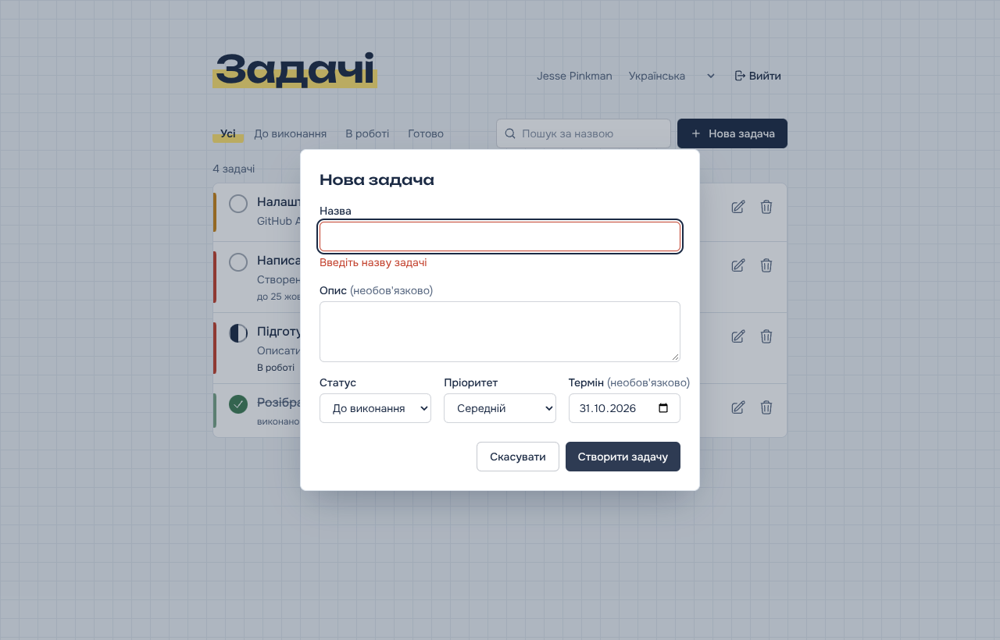 Валідація форми | 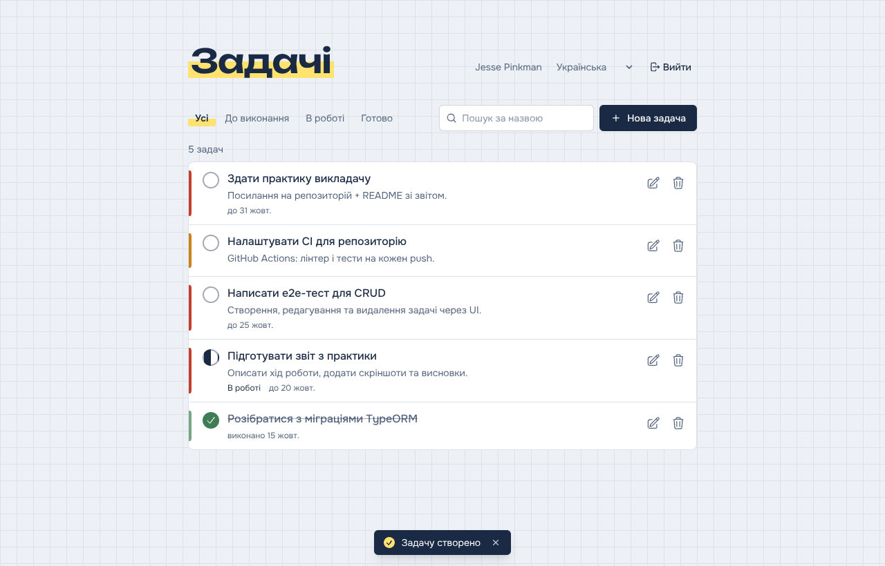 Задачу створено |
| 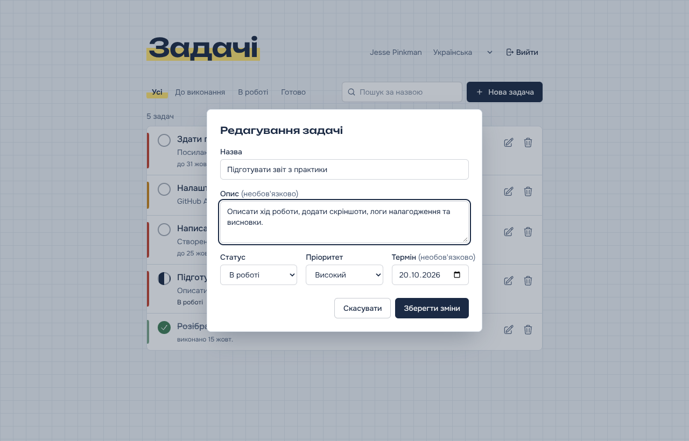 Редагування | 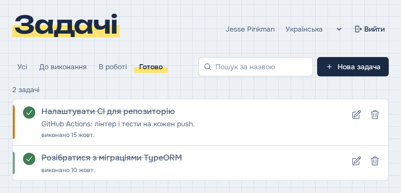 Фільтр «Готово» |
| 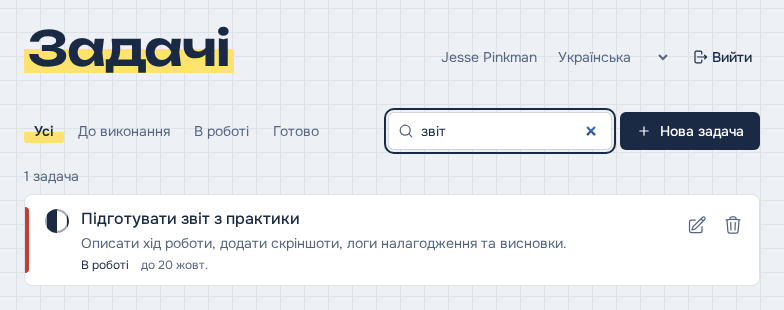 Пошук | 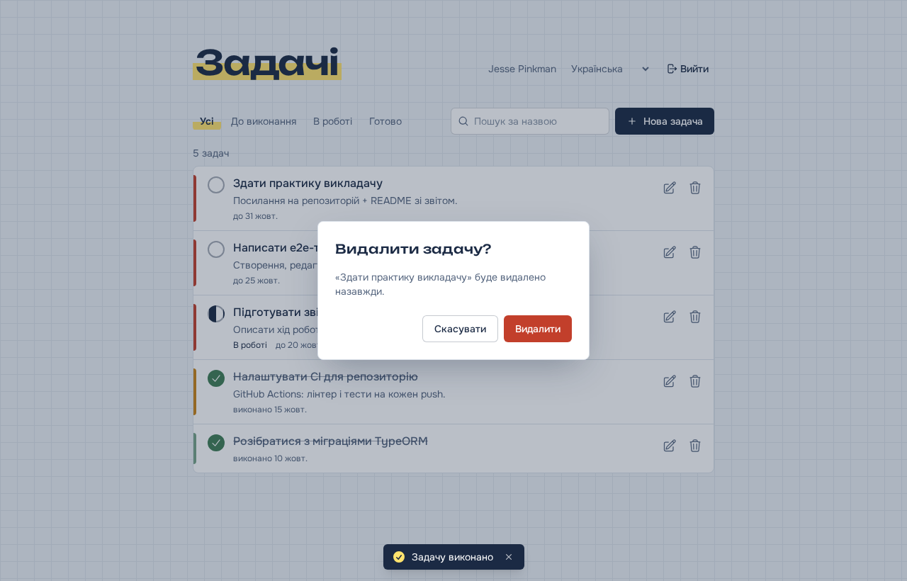 Підтвердження видалення |
| 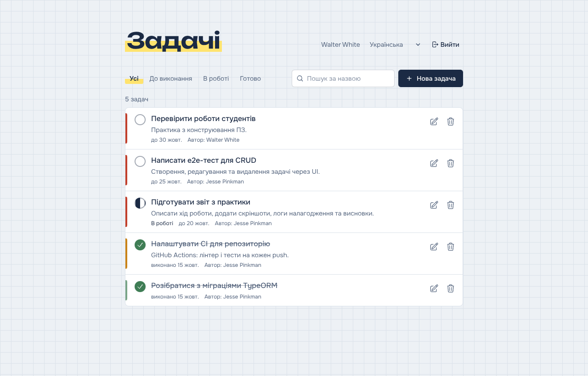 Адміністратор бачить авторів | 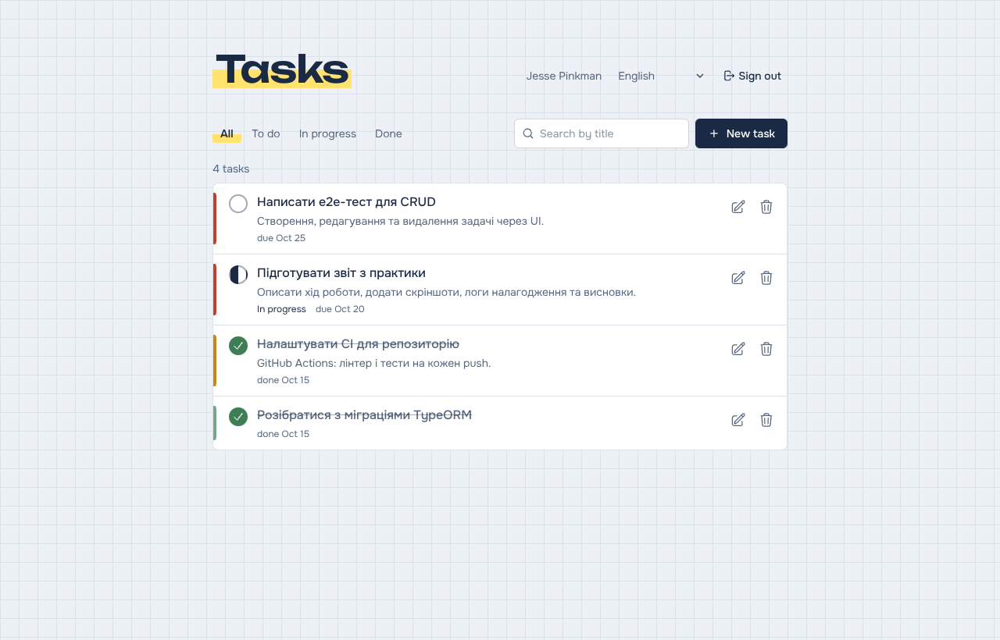 Англійська локалізація |

Мобільна версія — [`14-mobile.png`](docs/screenshots/14-mobile.png).

---

## 6. Тестування

| Набір | Команда | Результат |
|---|---|---|
| Сервер: інтеграційні тести (mocha + supertest, реальна БД) | `cd server && npm run test:local` | **22 passing** (8 стартера + 2 errorHandler + 12 tasks) |
| Клієнт: unit-тести (Vitest) | `cd client && pnpm exec vitest run src/` | **5 passed** |
| Клієнт: e2e (Playwright, реальні API і UI) | `cd client && pnpm test:e2e` | **2 passed** |
| Сервер: сценарій CRUD через HTTP | `cd server && npm run demo:api` | усі кроки, останній — `HTTP 404` після видалення |
| Статичний аналіз | `npm run lint`, `pnpm lint`, `tsc --noEmit` | без помилок |

`test:local` запускає тестовий сервер на порту 4100, тому не заважає dev-серверу на `:4000`. E2E-тест проходить повний сценарій українською: вхід, порожня форма → помилка, створення, редагування, виконання, фільтр, пошук, видалення, вихід. На Windows Playwright використовує встановлений Microsoft Edge; на інших системах потрібен `npx playwright install chromium`.

---

## 7. Зв'язок із лекціями

| Тема лекції | Де в коді |
|---|---|
| Шарова архітектура, SRP | `modules/tasks/*`: controller / service / repository / dto |
| Dependency Injection, composition root | `task.routes.ts` |
| DIP, Ports & Adapters | сервіс залежить від репозиторію, а не від TypeORM напряму |
| DRY | `asyncHandler`, `describeError`, спільна схема форми |
| Middleware трьох рівнів | `app.use(cors)` · `router.use(checkJwt)` · `validateTaskBody` |
| Централізована обробка помилок | `middleware/errorHandler.ts` |
| ORM, зв'язки, Data Mapper | `Task.ts` (`@ManyToOne`), `TaskRepository` |
| Міграції, `up`/`down`, не довіряти автогенерації | `orm/migrations/*-CreateTasks.ts`, пункт 7 розділу 3 |
| REST, методи і статуси HTTP | таблиця API: 200/201/400/404, `Location` |
| JWT, RBAC, CORS | `checkJwt`, роль ADMINISTRATOR у сервісі, `exposedHeaders` |
| Змінні оточення, секрети | `server/.env`, `client/.env` (`VITE_API_URL`) |
| React-компоненти, хуки | `features/tasks/*` |
| Стейт-менеджмент | TanStack Query (серверний стан) + Zustand (клієнтський) |
| Маршрутизація SPA (TanStack Router) | `routes/*`, типізовані search params |
| Utility-first CSS (Tailwind) | `styles/tailwind.css`, тема через `@theme` |
| i18n, a11y | `assets/locales/*`, Headless UI, aria-атрибути |
| Інструменти розробника, налагодження | `.vscode/launch.json`, `docs/debug/*`, TanStack Devtools |

---

## 8. Висновки

У ході роботи досліджено типову структуру клієнтського і серверного застосунків на TypeScript. Налагодження з точками зупину виявило реальну помилку обробника помилок, яку не видно з коду контролерів. Запуск стартерів поза Docker показав ще кілька проблем: неправильні імпорти, порядок завантаження змінних оточення, конфлікт з'єднань, неробочий Vitest.

Нова сутність `Task` реалізована за шаровою архітектурою з лекцій. Бізнес-правила (власник, роль, `completedAt`) живуть у сервісі, доступ до даних — у репозиторії, HTTP — у тонкому контролері. Окремий урок — **автогенеровану міграцію треба читати**: перша версія видаляла колонки з даними користувачів через розбіжність між сутністю і схемою (на заповненій таблиці її відкотила б транзакція, але це збіг, а не захист). Друга знахідка — `timestamp` без часової зони дає зсув дат, коли часові пояси Node і PostgreSQL різні.

Клієнт поєднує TanStack Router (типізовані фільтри в URL), TanStack Query (серверний стан) і React Hook Form + Zod (валідація, узгоджена із сервером). Працездатність підтверджена 22 інтеграційними тестами сервера, unit-тестами і e2e-сценарієм Playwright.

---

## 9. Відомі обмеження

- Колонки `created_at`/`updated_at` таблиці `users` зі стартера мають тип `timestamp` без часової зони — та сама проблема зі зсувом, що й у пункті про `timestamptz`; таблицю `users` не змінювали.
- `checkJwt` стартера повертає **400**, а не 401, якщо заголовок `Authorization` відсутній; поведінку залишено як у стартері.
- JWT зберігається в `sessionStorage`. Це простіше за httpOnly-cookie, але вразливе до XSS (тема лекції про сесії).
- Повна Docker-конфігурація стартера (`docker compose -f docker-compose.yml -f docker-compose.dev.yml up --build` у каталозі `server`) збережена: контейнер сам виконує міграції й сиди, включно із задачами.
- Продакшн-збірка клієнта — один бандл ~530 КБ (Vite попереджає про розмір); code splitting не налаштовувався.
